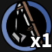

  <picture>
    
  </picture>
  <h1 align="center">Auto Fishing in Critical Revengeance</h1> 
  <h>This is auto fishing in Critical Revengeance <a href="https://www.roblox.com/games/14233281398/Critical-Revengeance-PT3">(Game from Roblox)</a>. Enjoy!</h>
  
Big thanks to Ashelayah and WaterKansuza

<h2>Tutorial</h2>
<table>
  <tr>
    <th>
    <picture>
      
    </picture>
    </th>
    <th>This is the GUI of the Macro (I'm still learning so it simple)</th>
  </tr>
</table>

<b style="color: red;">You have to equip the <i>Fishing Rod</i> first.</b> If you forgot, you can F3/Turn off and euip that.

First you have to go to the Fishing Place and <b>Stand</b> on the blue part under you. After that you press F1/Turn on Button to start F3/Turn off button to Turn off/Quit the Programme

## ⚠️ Disclaimer

> **Please read this section carefully before downloading, running, modifying, or distributing this project. By using this project, you acknowledge that you have read, understood, and agreed to everything below.**

### 1. Purpose and Scope
This project is provided for **educational, personal, and experimental purposes only**. It was created to demonstrate programming concepts such as input automation, scripting, and software design. It is not intended to harm any person, service, or company.

### 2. No Affiliation
This project is an independent, unofficial work. It is **not affiliated with, endorsed by, sponsored by, or connected in any way to Critical Revengeance, Roblox**, or any of their subsidiaries or partners. All game names, trademarks, logos, characters, sounds, images, and other assets mentioned or referenced belong to their respective owners and are used only for identification purposes.

### 3. Terms of Service and Risk of Account Action
Using macros, scripts, or any form of automation may **violate the Terms of Service, End User License Agreement, or Rules of Conduct** of Critical Revengeance or other games. Possible consequences include, but are not limited to: warnings, temporary suspension, permanent account bans, hardware bans, loss of items, progress, or purchased content.

- You are **solely responsible** for reading and complying with the rules of any game or service you use this project with.
- **The author is not responsible** for any penalty, ban, loss, or damage resulting from your use of this project.
- If a game's rules prohibit automation, **do not use this project with that game.**

### 4. Fair Play
This project is **not designed or intended to be used for cheating**, gaining an unfair advantage over other players, or disrupting the experience of others. Do not use it in competitive, ranked, tournament, or anti-cheat-protected environments. The author does not support or encourage cheating of any kind.

### 5. No Game Assets or Game Modification
This repository **does not intend to include or distribute** any copyrighted game assets (such as audio, images, models, or game data) owned by third parties. Unless explicitly stated otherwise, this project [only simulates keyboard/mouse input and does not read, modify, or inject into game memory or game files]. If you add third-party assets to your own copy, you are responsible for having the proper rights to them.

### 6. No Warranty
This project is provided **"AS IS"**, without warranty of any kind, express or implied, including but not limited to warranties of merchantability, fitness for a particular purpose, accuracy, reliability, and non-infringement. The author does not guarantee that the project will work correctly, work at all, be error-free, be secure, or continue to work after game updates.

### 7. Limitation of Liability
**TO THE MAXIMUM EXTENT PERMITTED BY APPLICABLE LAW, IN NO EVENT SHALL THE AUTHOR(S) OR CONTRIBUTOR(S) BE LIABLE FOR ANY CLAIM, DAMAGES, OR OTHER LIABILITY, WHETHER IN AN ACTION OF CONTRACT, TORT, OR OTHERWISE, ARISING FROM, OUT OF, OR IN CONNECTION WITH THIS PROJECT OR THE USE OR OTHER DEALINGS IN IT.** This includes direct, indirect, incidental, special, or consequential damages such as account loss, data loss, device malfunction, or loss of profit.

### 8. Security and Antivirus Notice
Programs that simulate keyboard or mouse input, as well as compiled scripts (for example `.exe` files built from AutoHotkey), are sometimes **flagged as suspicious by antivirus software (false positives)**.

- Always review the source code before running it.
- Only download releases from this official repository. Do not trust copies from unknown sources.
- The author is not responsible for modified, repackaged, or malicious copies distributed by third parties.
- Run the project at your own risk, and consider testing it in a safe environment first.

### 9. Privacy
[This project does not collect, store, or transmit any personal data.] If you modify it to do so, you are responsible for complying with applicable privacy laws.

### 10. Third-Party Software
This project may depend on third-party software or libraries (for example [AutoHotkey]), each licensed under its own terms. The MIT License of this project applies **only to the original code written by the author**. You are responsible for complying with the licenses of any third-party components.

### 11. User Responsibility and Local Laws
You are responsible for ensuring that your use of this project complies with all laws and regulations that apply to you, as well as the rules of any platform you use it on.

### 12. Forks, Modifications, and Redistribution
You may modify and redistribute this project under the terms of the MIT License. Forks and derivative works are **independent projects**. The author is not responsible for their content, behavior, or consequences, and is not required to support them.

### 13. No Obligation of Support or Updates
The author has no obligation to maintain, update, fix, or provide support for this project. It may stop working at any time due to game updates, system changes, or other reasons, and may be modified or removed without notice.

### 14. Rights Holders and Takedown
If you are a copyright or trademark owner and believe that any part of this project infringes your rights, please open an issue. I will review the request and respond promptly, including removing the relevant content when appropriate.

### 15. Acceptance
If you do not agree with any part of this disclaimer, **do not use this project.** Your use of the project means you accept all of the above.
